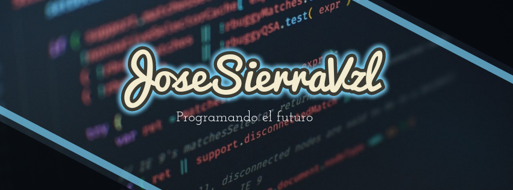

  

  <b>🇬🇧 English</b> · <a href="#-español">🇪🇸 Español</a>

## Hi, I'm Jose Alejandro 👋

**Full-stack developer from Venezuela 🇻🇪** focused on **PHP (Symfony / Laravel)** and **Vue.js**, with 4+ years building production web apps: e-commerce, a cryptocurrency platform and business sites.

- 🛒 Former **development lead at Takeit** (e-commerce) at Ciph3r
- 🪙 Built features and fixes for **MintMe**, a crypto web platform (Symfony + Vue + Docker)
- 🧑‍🏫 Onboarded and reviewed code from other developers on every team I've joined
- 🎓 Computer Engineering — UNETI
<!-- TODO: elige una línea y bórrala si no aplica -->
- 🔭 Currently: open to remote full-stack / backend roles

### 🛠 Tech stack

**Main**

  

**Also worked with**

  

Testing: PHPUnit · Vue Test Utils — Livewire · Alpine.js

### 📫 Contact

---

<h2>🇪🇸 Español</h2>

## Hola, soy Jose Alejandro 👋

**Desarrollador full-stack venezolano 🇻🇪** enfocado en **PHP (Symfony / Laravel)** y **Vue.js**, con más de 4 años construyendo aplicaciones web en producción: e-commerce, una plataforma de criptomonedas y sitios para negocios.

- 🛒 Fui **líder de desarrollo en Takeit** (e-commerce) en Ciph3r
- 🪙 Desarrollé funcionalidades y correcciones para **MintMe**, plataforma web cripto (Symfony + Vue + Docker)
- 🧑‍🏫 He guiado la incorporación y revisado código de otros desarrolladores en cada equipo
- 🎓 Ingeniería en Computación — UNETI
- 🔭 Actualmente: abierto a roles remotos full-stack / backend

**Stack principal:** PHP, Symfony, Laravel, Vue.js, JavaScript, TypeScript, MySQL, Docker, Git
**También:** React, Next.js, Node.js, Express, Python, Tailwind, Sass, Bootstrap, Webpack, Linux, Figma

📫 [LinkedIn](https://www.linkedin.com/in/jamsve/) · [Email](mailto:sierramedezjosealejandro@gmail.com) · [Telegram](https://t.me/jamsve)

